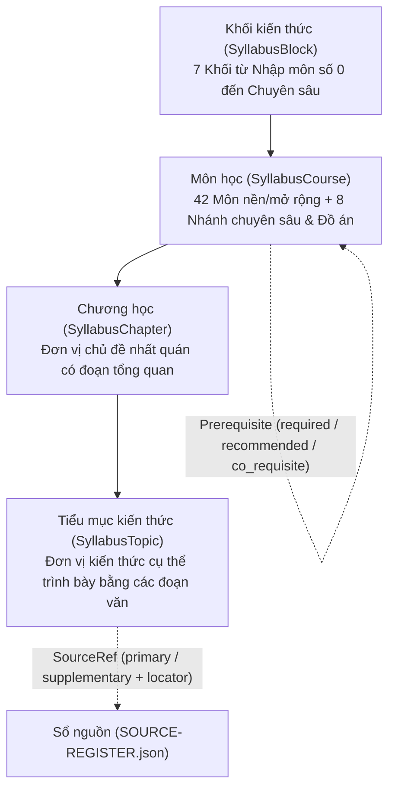

# THIẾT KẾ KIẾN TRÚC & HỢP ĐỒNG NỘI DUNG SYLLABUS V3 (`DESIGN.md`)

Phiên bản: `3.0.0-draft` — Ngày lập: `2026-11-07` (Asia/Saigon)

---

## 1. Mục tiêu Thiết kế Cốt lõi

Chuyển đổi chương trình từ mô hình **danh sách nhiệm vụ thực hành cá nhân hóa (419 task nodes)** sang **chương trình Khoa học Máy tính chuẩn mực bắt đầu từ số 0 (Academic Syllabus from Zero)**.

Người học chưa từng biết lập trình hoặc thuật toán khi đọc vào từng môn, từng chương, từng tiểu mục sẽ nắm rõ:
1. **Đối tượng nghiên cứu:** Phần này nghiên cứu cấu trúc, hiện tượng hay mô hình nào?
2. **Khái niệm và phương pháp:** Những định nghĩa, định lý, cơ chế phần cứng/phần mềm hay thuật toán cụ thể nào được xây dựng?
3. **Quan hệ cấu trúc:** Các khái niệm trong chương liên kết với nhau ra sao (ví dụ: từ mô hình hóa truy hồi → phương trình đặc trưng → nghiệm đơn → nghiệm bội/phức → hệ không thuần nhất → hàm sinh)?
4. **Điều kiện áp dụng và giới hạn (`boundaries`):** Phương pháp chỉ đúng dưới giả thiết nào? Khi nào mô hình giảng dạy khác với hệ thống thực tế?
5. **Nguồn học liệu gốc (`sources`):** Đọc chương/mục cụ thể nào trong giáo trình mở hoặc tài liệu chính thức?

---

## 2. Phân cấp Nội dung 4 Tầng (`Khối → Môn → Chương → Tiểu mục`)



### 2.1. Định nghĩa 3 mức độ học thuật (`level`) và 3 Quyết định Kiến trúc đã chốt
- **`core` (Nền chung bắt buộc):** Kiến thức cốt lõi mà mọi người học CS từ số 0 cần đi qua để hiểu cơ chế tính toán, lập trình, toán nền, thuật toán, hệ thống và kỹ nghệ phần mềm. Không phụ thuộc ngầm vào bất kỳ mục `extension` hay `specialization` nào.
- **`extension` (Mở rộng trong môn):** Các chủ đề nâng cao hoặc cần công cụ toán/hệ thống bổ trợ trong một môn nền (ví dụ: tiểu mục các giai đoạn dịch và liên kết chi tiết hoặc `std::string_view` trong Lập trình nhập môn; tiểu mục cận kẹp tích phân và công thức Stirling cần Giải tích `CS-11` trong Toán rời rạc). Có thể đọc ở vòng thứ hai hoặc học sau khi hoàn tất môn tiên quyết của tiểu mục mà không làm đứt mạch các môn `core` tiếp theo.
- **`specialization` (Chuyên sâu tự chọn):** Các chương hoặc nhánh đào sâu theo hướng chuyên ngành ở Khối VII (Hệ điều hành nâng cao với xv6, Hệ quản trị dữ liệu chuyên sâu, Trình biên dịch & VM, Hệ phân tán & đồng thuận Raft, Thị giác máy tính, Xử lý ngôn ngữ tự nhiên, Đồ họa ray tracing/pipeline, Bảo mật hệ thống).
- **Ba quyết định thiết kế đã chốt (Q1, Q2, Q3):**
  - **Q1 (Phạm vi nhánh chuyên sâu — Phương án A linh hoạt):** Các nhánh chuyên sâu ở Khối VII có syllabus thật với chương mục, điều kiện đầu vào và nguồn cụ thể; tuy nhiên **không áp công thức cứng 4 chương × 3–4 tiểu mục hoặc cùng độ sâu** cho mọi môn, mà phân rã theo nội dung thực chất, nguồn giáo trình và vai trò môn học (`core` vs `extension` vs `specialization`).
  - **Q2 (Bảo toàn Legacy & Tiến độ — Phương án A):** Giữ nguyên dữ liệu và chế độ xem lưu trữ v2.1 riêng biệt; sử dụng namespace tiến độ độc lập `cs-syllabus.progress.v3` (`curriculumId: "cs-syllabus-v3"`). Tuyệt đối không tự ánh xạ trạng thái tick nhiệm vụ cũ thành đã học chương mới.
  - **Q3 (Thứ tự biên soạn — Phương án B):** Triển khai theo lối đi từ số 0 và đồ thị tiên quyết (toán nền song hành hợp lý với lập trình/thuật toán); khóa cổng M2 để Codex review đạt trước khi nhân rộng hàng loạt sang M3–M5. Giữ nguyên hệ thống 10 mốc `M0–M9` theo `PLAN-CS-SYLLABUS-FROM-ZERO-ANTIGRAVITY.md`.

---

## 3. Hợp đồng Schema Dữ liệu (`src/syllabus/schema.mjs`)

Dự án hiện dùng JavaScript ES Modules (`.js` / `.mjs`) mà không dùng TypeScript compiler. Do đó, schema được định nghĩa bằng JSDoc kết hợp bộ kiểm tra thực thi nghiêm ngặt tại runtime/test-time trong `src/syllabus/schema.mjs`.

```js
/**
 * @typedef {Object} SourceRecord
 * @property {string} id - Định danh nguồn ổn định (vd: 'mit-6042j-2015', 'dmoi-3e', 'ostep-v110')
 * @property {string} authorsOrOrg - Tác giả hoặc tổ chức phát hành
 * @property {string} title - Tên đầy đủ của giáo trình / khóa học / tài liệu
 * @property {string} url - Đường dẫn truy cập chính thức
 * @property {string} versionOrTerm - Phiên bản sách hoặc học kỳ khóa học
 * @property {string} accessedDate - Ngày kiểm tra nguồn (YYYY-MM-DD)
 * @property {'url_seen' | 'syllabus_toc_read' | 'section_read_for_authoring' | 'exercises_labs_tested'} verificationLevel
 * @property {string} freeAccessRoute - Cách truy cập hợp pháp, miễn phí 100%
 * @property {string} scopeUsed - Phạm vi sử dụng trong chương trình
 */

/**
 * @typedef {Object} SourceRef
 * @property {string} sourceId - Trỏ tới SourceRecord.id trong SOURCE-REGISTER.json
 * @property {string} locator - Chương, mục, bài giảng hoặc trang cụ thể (không để chung chung)
 * @property {'primary' | 'supplementary'} relationship - Vai trò của nguồn đối với chương/tiểu mục
 */

/**
 * @typedef {Object} Prerequisite
 * @property {string} courseId - Mã môn điều kiện trước
 * @property {'required' | 'recommended' | 'co_requisite'} type - Loại điều kiện
 * @property {string} reason - Lý do cụ thể vì sao cần nền kiến thức này
 */

/**
 * @typedef {Object} SyllabusTopic
 * @property {string} id - ID ổn định theo kiến thức (vd: 'dm-recurrences-repeated-complex-roots')
 * @property {string} title - Tên tiểu mục rõ nghĩa học thuật
 * @property {string[]} paragraphs - Mảng các đoạn văn học thuật (mỗi đoạn là văn xuôi hoàn chỉnh)
 * @property {'core' | 'extension' | 'specialization'} level
 * @property {SourceRef[]} sources - Ít nhất 1 nguồn có locator cụ thể
 */

/**
 * @typedef {Object} SyllabusChapter
 * @property {string} id - ID chương ổn định (vd: 'dm-recurrences')
 * @property {string} title - Tên chương
 * @property {string[]} overview - Các đoạn văn tổng quan chương
 * @property {SyllabusTopic[]} topics - Danh sách tiểu mục theo trình tự logic
 * @property {SourceRef[]} sources - Nguồn chính và phụ của toàn chương
 */

/**
 * @typedef {Object} SyllabusCourse
 * @property {string} id - ID môn ổn định (vd: 'discrete-math', 'intro-programming')
 * @property {string} code - Mã hiển thị gợi ý (vd: 'CS-09', 'CS-04') — không quyết định danh tính
 * @property {string} title - Tên môn học
 * @property {string} blockId - Thuộc khối kiến thức nào ('block-1' .. 'block-7')
 * @property {'core' | 'extension' | 'specialization'} level
 * @property {string[]} overview - Các đoạn văn mô tả tổng quan môn học, đối tượng và phạm vi
 * @property {Prerequisite[]} prerequisites - Danh sách điều kiện trước có phân loại
 * @property {SyllabusChapter[]} chapters - Danh sách các chương của môn
 * @property {string[]} boundaries - Các giới hạn học thuật và phân biệt mô hình lý thuyết vs thực tế
 * @property {SourceRef[]} sources - Nguồn trục và nguồn bổ trợ của môn
 */
```

---

## 4. Quy tắc Kiểm định Tự động (`validateSyllabusCatalog` & `validateSyllabusCourse`)

Bộ kiểm định trong `src/syllabus/schema.mjs` tự động từ chối dữ liệu nếu vi phạm bất kỳ điều kiện nào sau đây:
1. **Tính duy nhất của ID:** Không có 2 khối, 2 môn, 2 chương hoặc 2 tiểu mục trùng `id`. Không tái sử dụng ID của 419 task cũ nếu khác cấp độ/ý nghĩa.
2. **Toàn vẹn tham chiếu (`Referential Integrity`):**
   - Mọi `SourceRef.sourceId` phải tồn tại trong `SOURCE-REGISTER.json` và có `locator` khác rỗng (tối thiểu 4 ký tự, chỉ rõ chương/mục).
   - Mọi `Prerequisite.courseId` phải tồn tại trong danh mục môn và không tự trỏ chính nó (`courseId !== course.id`).
3. **Tính phi chu trình của đồ thị tiên quyết (`DAG Acyclicity`):**
   - Đồ thị tạo bởi các cạnh `type === 'required'` phải tuyệt đối không có chu trình (kiểm chứng bằng thuật toán DFS 3 màu và sắp xếp topo Kahn).
   - Quan hệ `co_requisite` không được mã hóa thành hai cạnh `required` ngược chiều nhau.
4. **Chuẩn mực văn xuôi học thuật (Chống tái sử dụng Checklist cũ):**
   - Mỗi môn phải có `overview` tối thiểu 120 từ; mỗi chương hoàn chỉnh có `overview` tối thiểu 70 từ; mỗi tiểu mục có `paragraphs` tối thiểu 55 từ.
   - Cấm các chuỗi gạch đầu dòng ẩn trong đoạn văn (không bắt đầu bằng `- `, `* `, `+ `, `[ ]`).
   - Cấm các câu mệnh lệnh kiểu giao việc cũ ở đầu câu (`Hãy viết...`, `Tự cài...`, `Chạy lệnh...`, `Ghi lại...`, `Nộp...`).
   - Cấm các từ ngữ quảng cáo sáo rỗng hoặc cam kết ngoài phạm vi (`cam kết đậu`, `bảo đảm GPA`, `chuẩn quốc tế 100%`).

---

## 5. Tổ chức Thư mục Thực tế

```text
src/
  syllabus/
    index.mjs                                   # Điểm xuất dữ liệu Syllabus v3 (Blocks, Catalog, Courses, Sources)
    schema.mjs                                  # Bộ kiểm định cấu trúc, thành viên catalog/chương, DAG, nguồn và văn phong
    sources.mjs                                 # Mô-đun ESM thuần trình duyệt chứa 42 bản ghi nguồn (đồng bộ 100% với SOURCE-REGISTER.json)
    catalog.mjs                                 # Toàn bộ 7 Khối & Danh mục 50 môn học kèm đồ thị Prerequisite
    courses/
      intro-programming.mjs                     # [M2] Môn 04: Lập trình nhập môn (đầy đủ 6 chương, 24 tiểu mục: 22 core + 2 extension)
      discrete-math.mjs                         # [M2] Môn 09: Toán rời rạc (đầy đủ 10 chương, 34 tiểu mục: 33 core + 1 extension, gồm Hệ thức đệ quy 6 tiểu mục)
      operating-systems-vm-sample.mjs           # [M2] Môn 25: Hệ điều hành — Chương mẫu Bộ nhớ ảo & Phân trang (1 chương, 6 tiểu mục)
  syllabus-progress.mjs                         # Quản lý tiến độ v3 độc lập ('cs-syllabus.progress.v3'), kiểm tra cấu trúc & cha–con
scripts/
  backup-roadmap-v21.mjs                        # Kịch bản xác minh xuất xứ & bảo vệ chống ghi đè bản sao lưu 2.1.0 (mặc định --verify)
  generate-m1-docs.mjs                          # Kịch bản sinh tự động COURSE-CATALOG.md & PREREQUISITES.md từ dữ liệu nguồn
  export-syllabus-preview.mjs                   # Kịch bản xuất bản đọc Markdown cho các môn mẫu M2
tests/
  syllabus-v3.test.mjs                          # Bộ kiểm thử tự động cho M0, M1, M2, bảo vệ backup và tiến độ v3
docs/
  backups/
    ROADMAP-BEFORE-SYLLABUS-REWRITE.md          # Bản sao lưu toàn diện 419 node / 42 môn / 7 tracks (896,954 bytes, SHA-256: 78094dc6...)
  syllabus-v3/
    IMPLEMENTATION-STATE.md                     # Trạng thái thực thi & baseline theo mốc M0–M9
    DESIGN.md                                   # Tài liệu thiết kế này
    LEGACY-AND-PROGRESS.md                      # ADR bảo toàn bản cũ và tách biệt tiến độ v3
    COURSE-CATALOG.md                           # Danh mục 7 khối, 42 môn nền/mở rộng & 8 nhánh chuyên sâu (tổng 50 môn)
    SOURCE-REGISTER.json                        # Sổ đăng ký 42 nguồn học thuật có phân cấp mức kiểm chứng
    COVERAGE-MATRIX.csv                         # Ma trận đối chiếu 17 vùng kiến thức CS2023
    PREREQUISITES.md                            # Đồ thị điều kiện trước & lộ trình học từ số 0
    M2-SAMPLE-SYLLABUS.md                       # Bản xuất Markdown toàn văn các môn mẫu M2 (17 chương, 64 tiểu mục, 19,973 từ)
    CONTENT-REVIEW.md                           # Biên bản tự rà soát nội dung M1–M2 sau sửa theo báo cáo Codex
    VERIFICATION.md                             # Bằng chứng chạy kiểm thử và kiểm tra toàn vẹn
    REVIEW-PACKET.md                            # Gói bàn giao cổng review M0–M2 (sau sửa) cho Codex
```
