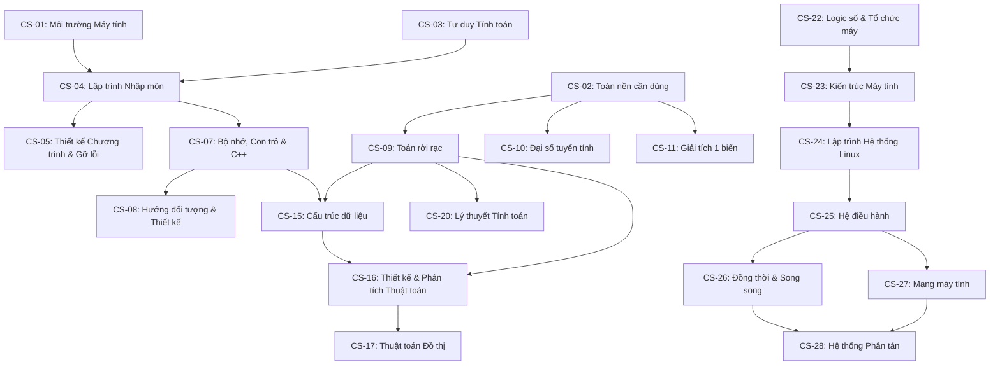

# Đồ Thị Tiên Quyết (Prerequisite DAG) & Lộ Trình Học Từ Con Số 0

> **Kiểm định toán học:** Đồ thị tiên quyết bắt buộc (`required`) gồm 50 đỉnh (`CS-01` đến `CS-50`) đã được kiểm tra bằng thuật toán duyệt đồ thị có hướng 3 màu (DFS cycle detection) và sắp xếp tô-pô Kahn: **0 chu trình (DAG hợp lệ 100%)**.

## 1. Phân biệt 3 loại quan hệ phụ thuộc

1. **`required` (Tiên quyết bắt buộc):** Người học không thể nắm bắt định nghĩa hoặc chứng minh trong môn đích nếu chưa hoàn thành môn nguồn. Ví dụ: không thể học giải hệ thức đệ quy hay đồ thị trong `discrete-math` (`CS-09`) nếu chưa nắm vững ký hiệu hàm, đa thức, lũy thừa và dãy tổng ở `math-bridge` (`CS-02`).
2. **`recommended` (Khuyến nghị học trước):** Cung cấp trực giác hoặc công cụ bổ trợ giúp hiểu sâu hơn các trường hợp biên, nhưng không chặn việc bắt đầu môn học.
3. **`co_requisite` (Học song hành):** Hai môn bổ trợ trực tiếp cho nhau trong cùng một chặng.

## 2. Sơ đồ luồng phụ thuộc cốt lõi (Mermaid)

## 3. Thứ tự Tô-pô chuẩn (Topological Order) từ Con Số 0

| Thứ tự | Mã môn | ID | Tên môn học | Khối | Tiên quyết bắt buộc (`required`) | Tiên quyết khuyến nghị / song hành |
| :---: | :---: | :--- | :--- | :---: | :--- | :--- |
| 1 | **CS-01** | `computing-environment` | Làm quen máy tính và môi trường học | `block-1` | *(Khởi đầu)* | — |
| 2 | **CS-02** | `math-bridge` | Toán nền cần dùng | `block-1` | *(Khởi đầu)* | — |
| 3 | **CS-03** | `computational-thinking` | Nhập môn CS và tư duy tính toán | `block-1` | *(Khởi đầu)* | `computing-environment` (co_requisite), `math-bridge` (co_requisite) |
| 4 | **CS-04** | `intro-programming` | Lập trình nhập môn | `block-1` | `computing-environment` | `computational-thinking` (co_requisite), `math-bridge` (co_requisite) |
| 5 | **CS-09** | `discrete-math` | Toán rời rạc và lập luận cho CS | `block-2` | `math-bridge` | `computational-thinking` (recommended), `single-variable-calculus` (recommended) |
| 6 | **CS-10** | `linear-algebra` | Đại số tuyến tính | `block-2` | `math-bridge` | `discrete-math` (recommended) |
| 7 | **CS-11** | `single-variable-calculus` | Giải tích một biến | `block-2` | `math-bridge` | — |
| 8 | **CS-05** | `program-design-debugging` | Thiết kế chương trình và debug | `block-1` | `intro-programming` | — |
| 9 | **CS-06** | `git-dev-tools` | Git và công cụ phát triển | `block-1` | `computing-environment`, `intro-programming` | — |
| 10 | **CS-22** | `digital-logic-computer-organization` | Logic số và tổ chức máy | `block-4` | `discrete-math`, `intro-programming` | — |
| 11 | **CS-12** | `multivariable-calculus-optimization` | Giải tích nhiều biến và tối ưu | `block-2` | `single-variable-calculus`, `linear-algebra` | — |
| 12 | **CS-13** | `probability` | Xác suất | `block-2` | `discrete-math`, `single-variable-calculus` | `multivariable-calculus-optimization` (co_requisite) |
| 13 | **CS-07** | `cpp-memory-model` | C++ và mô hình bộ nhớ | `block-2` | `intro-programming`, `program-design-debugging` | — |
| 14 | **CS-39** | `human-computer-interaction` | Tương tác người–máy | `block-6` | `program-design-debugging` | `web-network-applications` (recommended) |
| 15 | **CS-14** | `statistics-inference` | Thống kê và thiết kế suy luận | `block-2` | `probability`, `linear-algebra` | — |
| 16 | **CS-08** | `object-oriented-programming` | Lập trình hướng đối tượng | `block-2` | `cpp-memory-model` | — |
| 17 | **CS-23** | `computer-architecture` | Kiến trúc máy tính | `block-4` | `digital-logic-computer-organization`, `cpp-memory-model` | — |
| 18 | **CS-38** | `computer-graphics` | Đồ họa máy tính | `block-6` | `linear-algebra`, `multivariable-calculus-optimization`, `cpp-memory-model` | — |
| 19 | **CS-36** | `machine-learning` | Machine learning | `block-6` | `linear-algebra`, `multivariable-calculus-optimization`, `statistics-inference` | — |
| 20 | **CS-41** | `scientific-computing-data-processing` | Tính toán khoa học và xử lý dữ liệu | `block-6` | `linear-algebra`, `single-variable-calculus`, `statistics-inference` | — |
| 21 | **CS-15** | `data-structures` | Cấu trúc dữ liệu | `block-3` | `cpp-memory-model`, `object-oriented-programming`, `discrete-math` | — |
| 22 | **CS-31** | `software-engineering` | Kỹ nghệ phần mềm | `block-5` | `object-oriented-programming`, `program-design-debugging`, `git-dev-tools` | — |
| 23 | **CS-24** | `linux-system-programming` | Linux/Unix và lập trình hệ thống | `block-4` | `git-dev-tools`, `cpp-memory-model`, `computer-architecture` | — |
| 24 | **CS-37** | `deep-learning-modern-models` | Deep learning và mô hình hiện đại | `block-6` | `machine-learning`, `multivariable-calculus-optimization`, `linear-algebra` | — |
| 25 | **CS-16** | `algorithms-design-analysis` | Phân tích và thiết kế thuật toán | `block-3` | `data-structures`, `discrete-math` | `probability` (recommended) |
| 26 | **CS-21** | `programming-languages-foundations` | Nền tảng ngôn ngữ lập trình | `block-3` | `object-oriented-programming`, `data-structures` | `formal-languages-computability` (recommended) |
| 27 | **CS-29** | `data-modeling-databases` | Mô hình dữ liệu và database | `block-5` | `discrete-math`, `data-structures` | — |
| 28 | **CS-42** | `ethics-society-cs-research` | Đạo đức, xã hội và nghiên cứu CS | `block-6` | `software-engineering`, `statistics-inference` | — |
| 29 | **CS-25** | `operating-systems` | Hệ điều hành | `block-4` | `computer-architecture`, `linux-system-programming`, `data-structures` | — |
| 30 | **CS-47** | `spec-computer-vision` | Chuyên sâu Thị giác máy tính (Computer Vision) | `block-7` | `deep-learning-modern-models`, `linear-algebra` | — |
| 31 | **CS-48** | `spec-natural-language-processing` | Chuyên sâu Xử lý ngôn ngữ tự nhiên (NLP) | `block-7` | `deep-learning-modern-models`, `probability` | — |
| 32 | **CS-17** | `graph-algorithms` | Thuật toán đồ thị | `block-3` | `data-structures`, `algorithms-design-analysis` | — |
| 33 | **CS-19** | `formal-languages-computability` | Ngôn ngữ hình thức và khả năng tính toán | `block-3` | `discrete-math`, `algorithms-design-analysis` | — |
| 34 | **CS-26** | `concurrency-parallelism` | Lập trình đồng thời và song song | `block-4` | `operating-systems`, `computer-architecture` | — |
| 35 | **CS-30** | `database-internals` | Bên trong hệ quản trị dữ liệu | `block-5` | `data-modeling-databases`, `operating-systems`, `data-structures` | — |
| 36 | **CS-43** | `spec-systems-os` | Chuyên sâu Hệ điều hành và Hệ thống (xv6 Kernel) | `block-7` | `operating-systems`, `linux-system-programming`, `computer-architecture` | — |
| 37 | **CS-18** | `advanced-algorithms` | Thuật toán mở rộng | `block-3` | `algorithms-design-analysis`, `graph-algorithms`, `probability` | — |
| 38 | **CS-27** | `computer-networks` | Mạng máy tính | `block-4` | `linux-system-programming`, `graph-algorithms` | — |
| 39 | **CS-35** | `ai-foundations` | AI nền tảng | `block-6` | `graph-algorithms`, `probability`, `discrete-math` | — |
| 40 | **CS-20** | `computational-complexity` | Độ phức tạp tính toán | `block-3` | `formal-languages-computability`, `graph-algorithms` | — |
| 41 | **CS-45** | `spec-compilers-runtime` | Chuyên sâu Ngôn ngữ, Trình biên dịch và Máy ảo | `block-7` | `programming-languages-foundations`, `computer-architecture`, `formal-languages-computability` | — |
| 42 | **CS-44** | `spec-database-storage` | Chuyên sâu Hệ quản trị dữ liệu và Lưu trữ | `block-7` | `database-internals`, `concurrency-parallelism` | — |
| 43 | **CS-28** | `distributed-systems` | Hệ phân tán | `block-4` | `operating-systems`, `concurrency-parallelism`, `computer-networks` | — |
| 44 | **CS-32** | `web-network-applications` | Web và ứng dụng qua mạng | `block-5` | `computer-networks`, `data-modeling-databases` | — |
| 45 | **CS-33** | `operations-performance-reliability` | Vận hành và hiệu năng | `block-5` | `operating-systems`, `computer-networks` | — |
| 46 | **CS-40** | `mobile-embedded-realtime` | Di động, nhúng và hệ thời gian thực | `block-6` | `computer-architecture`, `operating-systems`, `computer-networks` | — |
| 47 | **CS-46** | `spec-distributed-systems-advanced` | Chuyên sâu Hệ phân tán và Đồng thuận chịu lỗi | `block-7` | `distributed-systems`, `concurrency-parallelism` | — |
| 48 | **CS-34** | `security-privacy` | Bảo mật và riêng tư | `block-5` | `cpp-memory-model`, `operating-systems`, `web-network-applications` | — |
| 49 | **CS-50** | `capstone-synthesis-technical-writing` | Đồ án tổng hợp và trình bày kỹ thuật | `block-7` | `software-engineering`, `operations-performance-reliability`, `ethics-society-cs-research` | — |
| 50 | **CS-49** | `spec-security-advanced` | Chuyên sâu Bảo mật hệ thống, Ứng dụng và Mạng | `block-7` | `security-privacy`, `linux-system-programming`, `computer-networks` | — |

## 4. Chi tiết lý do phụ thuộc của từng môn học

### CS-01 — Làm quen máy tính và môi trường học (`computing-environment`)
- **Không có điều kiện tiên quyết:** Thiết kế cho người bắt đầu từ số 0.

### CS-02 — Toán nền cần dùng (`math-bridge`)
- **Không có điều kiện tiên quyết:** Thiết kế cho người bắt đầu từ số 0.

### CS-03 — Nhập môn CS và tư duy tính toán (`computational-thinking`)
- **`computing-environment`** [`co_requisite`]: Cần mô hình tệp và môi trường thực thi cơ bản để đối chiếu biểu diễn dữ liệu với máy tính thật.
- **`math-bridge`** [`co_requisite`]: Cần lũy thừa cơ số 2, logarit cơ số 2 và biến số cơ bản để theo dõi biểu diễn nhị phân và phép chia đôi không gian tìm kiếm.

### CS-04 — Lập trình nhập môn (`intro-programming`)
- **`computing-environment`** [`required`]: Cần biết thao tác tệp, đường dẫn, trình soạn thảo và gọi trình biên dịch từ terminal.
- **`computational-thinking`** [`co_requisite`]: Cần mô hình trạng thái, phân rã bài toán và lần vết thực thi để không học cú pháp một cách máy móc.
- **`math-bridge`** [`co_requisite`]: Cần nắm biến số, biểu thức đại số, phép chia nguyên/dư và hàm số cơ bản.

### CS-05 — Thiết kế chương trình và debug (`program-design-debugging`)
- **`intro-programming`** [`required`]: Cần viết và đọc được chương trình có hàm, vòng lặp, mảng và chuỗi để thực hành thiết kế và gỡ lỗi.

### CS-06 — Git và công cụ phát triển (`git-dev-tools`)
- **`computing-environment`** [`required`]: Cần nắm vững cây thư mục, đường dẫn và giao diện dòng lệnh.
- **`intro-programming`** [`required`]: Cần có các tệp mã nguồn thực tế để quản lý phiên bản, biên dịch đa tệp và xử lý xung đột.

### CS-07 — C++ và mô hình bộ nhớ (`cpp-memory-model`)
- **`intro-programming`** [`required`]: Cần nắm chắc kiểu dữ liệu, hàm, phạm vi biến và std::vector/std::string cơ bản.
- **`program-design-debugging`** [`required`]: Cần kỹ năng sử dụng debugger và đọc call stack trước khi chẩn đoán lỗi con trỏ và bộ nhớ động.

### CS-08 — Lập trình hướng đối tượng (`object-oriented-programming`)
- **`cpp-memory-model`** [`required`]: Cần hiểu thời gian sống đối tượng, con trỏ/tham chiếu, RAII và quyền sở hữu trước khi học đa hình động và quản lý tài nguyên trong lớp.

### CS-09 — Toán rời rạc và lập luận cho CS (`discrete-math`)
- **`math-bridge`** [`required`]: Cần nắm vững biến số, phương trình đa thức, số phức cơ sở, hàm số, lũy thừa, logarit và ký hiệu tổng cơ bản.
- **`computational-thinking`** [`recommended`]: Khái niệm trạng thái, bước chuyển trạng thái và điều kiện dừng giúp gắn kết trực tiếp logic và quy nạp với mô hình máy trạng thái.
- **`single-variable-calculus`** [`recommended`]: Toàn bộ phần cốt lõi (Chương 1–7, 9–10 và phần tổng đại số/tiệm cận của Chương 8) chỉ cần CS-02; riêng tiểu mục mở rộng về cận kẹp tích phân và xấp xỉ Stirling ở Chương 8 cần khái niệm tích phân xác định của CS-11.

### CS-10 — Đại số tuyến tính (`linear-algebra`)
- **`math-bridge`** [`required`]: Cần nắm hệ phương trình cơ bản, tọa độ phẳng và biến đổi đại số.
- **`discrete-math`** [`recommended`]: Tư duy chứng minh, tập hợp và ánh xạ từ Toán rời rạc giúp hiểu sâu không gian vector và hạt nhân/ảnh của ánh xạ tuyến tính.

### CS-11 — Giải tích một biến (`single-variable-calculus`)
- **`math-bridge`** [`required`]: Cần nắm vững hàm số, đa thức, hàm mũ, logarit và lượng giác.

### CS-12 — Giải tích nhiều biến và tối ưu (`multivariable-calculus-optimization`)
- **`single-variable-calculus`** [`required`]: Cần nắm vững đạo hàm, quy tắc dây chuyền một biến, khai triển Taylor và tích phân.
- **`linear-algebra`** [`required`]: Cần không gian vector, tích vô hướng, ma trận đối xứng xác định dương và trị riêng để xét ma trận Jacobian/Hessian.

### CS-13 — Xác suất (`probability`)
- **`discrete-math`** [`required`]: Cần lý thuyết tập hợp, nguyên lý đếm tổ hợp và tổng hữu hạn/chuỗi.
- **`single-variable-calculus`** [`required`]: Cần đạo hàm, tích phân xác định và tích phân suy rộng cho biến ngẫu nhiên liên tục.
- **`multivariable-calculus-optimization`** [`co_requisite`]: Cần tích phân kép cơ bản khi học phân phối xác suất đồng thời của hai biến liên tục.

### CS-14 — Thống kê và thiết kế suy luận (`statistics-inference`)
- **`probability`** [`required`]: Cần nắm vững biến ngẫu nhiên, kỳ vọng, phương sai, định lý Bayes và Định lý giới hạn trung tâm.
- **`linear-algebra`** [`required`]: Cần phép chiếu trực giao và bình phương tối thiểu cho mô hình hồi quy tuyến tính.

### CS-15 — Cấu trúc dữ liệu (`data-structures`)
- **`cpp-memory-model`** [`required`]: Cần nắm vững bộ nhớ liên tiếp vs cấp phát nút qua con trỏ, thời gian sống và độ cục bộ bộ nhớ.
- **`object-oriented-programming`** [`required`]: Cần nắm đóng gói bất biến của lớp và khuôn mẫu cơ bản để hiểu thiết kế container.
- **`discrete-math`** [`required`]: Cần quy nạp toán học, số học modulo, cây, đồ thị và ký hiệu tiệm cận.

### CS-16 — Phân tích và thiết kế thuật toán (`algorithms-design-analysis`)
- **`data-structures`** [`required`]: Cần nắm vững mảng, bảng băm, cây, đống nhị phân và phân tích khấu hao cơ bản.
- **`discrete-math`** [`required`]: Cần quy nạp toán học, bất biến vòng lặp, tổng tiệm cận và hệ thức đệ quy.
- **`probability`** [`recommended`]: Cần kỳ vọng và biến ngẫu nhiên chỉ thị để phân tích trường hợp trung bình của Quicksort ngẫu nhiên và bảng băm.

### CS-17 — Thuật toán đồ thị (`graph-algorithms`)
- **`data-structures`** [`required`]: Cần hàng đợi, ngăn xếp, hàng đợi ưu tiên (min-heap), Disjoint Set Union và biểu diễn đồ thị.
- **`algorithms-design-analysis`** [`required`]: Cần tư duy tham lam, quy hoạch động và chứng minh bất biến.

### CS-18 — Thuật toán mở rộng (`advanced-algorithms`)
- **`algorithms-design-analysis`** [`required`]: Cần nắm chắc chia để trị, quy hoạch động và phân tích tiệm cận.
- **`graph-algorithms`** [`required`]: Cần nền tảng đồ thị, cây và luồng.
- **`probability`** [`required`]: Cần xác suất cho phân tích thuật toán ngẫu nhiên và băm chuỗi.

### CS-19 — Ngôn ngữ hình thức và khả năng tính toán (`formal-languages-computability`)
- **`discrete-math`** [`required`]: Cần nắm chắc logic, tập hợp, hàm song ánh, chứng minh phản chứng và quy nạp cấu trúc.
- **`algorithms-design-analysis`** [`required`]: Cần khái niệm thuật toán xác định để đối chiếu với mô hình máy Turing.

### CS-20 — Độ phức tạp tính toán (`computational-complexity`)
- **`formal-languages-computability`** [`required`]: Cần mô hình Máy Turing, ngôn ngữ quyết định và kỹ thuật quy dẫn.
- **`graph-algorithms`** [`required`]: Cần nắm các bài toán đồ thị đa thức (2-SAT, MST, Shortest Path, Matching) để đối chiếu với các bài toán đồ thị NP-khó (3-SAT, TSP, Clique).

### CS-21 — Nền tảng ngôn ngữ lập trình (`programming-languages-foundations`)
- **`object-oriented-programming`** [`required`]: Cần kinh nghiệm với một ngôn ngữ biên dịch tĩnh (C++) để đối chiếu các cơ chế ngôn ngữ.
- **`data-structures`** [`required`]: Cần cấu trúc cây (AST), bảng băm (bảng ký hiệu/môi trường) và ngăn xếp.
- **`formal-languages-computability`** [`recommended`]: Văn phạm phi ngữ cảnh (CFG) giúp hiểu rõ quá trình phân tích cú pháp (parsing).

### CS-22 — Logic số và tổ chức máy (`digital-logic-computer-organization`)
- **`discrete-math`** [`required`]: Cần đại số Boolean, bảng chân trị và hệ đếm/số học nhị phân.
- **`intro-programming`** [`required`]: Cần hiểu khái niệm biến, địa chỉ và câu lệnh điều khiển để đối chiếu với thanh ghi và lệnh máy.

### CS-23 — Kiến trúc máy tính (`computer-architecture`)
- **`digital-logic-computer-organization`** [`required`]: Cần nắm vững biểu diễn số, mạch tuần tự, thanh ghi, ALU và datapath đơn chu kỳ.
- **`cpp-memory-model`** [`required`]: Cần hiểu con trỏ, mảng, struct alignment và khung ngăn xếp ở mức ngôn ngữ C/C++.

### CS-24 — Linux/Unix và lập trình hệ thống (`linux-system-programming`)
- **`git-dev-tools`** [`required`]: Cần nắm vững dòng lệnh shell, đường dẫn và quy trình build cơ bản.
- **`cpp-memory-model`** [`required`]: Cần hiểu sâu con trỏ, bố cục bộ nhớ và vùng đệm byte.
- **`computer-architecture`** [`required`]: Cần hiểu chế độ đặc quyền user/kernel, thanh ghi, ngắt và ngăn xếp.

### CS-25 — Hệ điều hành (`operating-systems`)
- **`computer-architecture`** [`required`]: Cần hiểu thanh ghi, ngắt phần cứng, chế độ đặc quyền CPU, bộ nhớ cache và MMU/TLB.
- **`linux-system-programming`** [`required`]: Cần hiểu giao diện tiến trình, lời gọi hệ thống và mô tả tệp từ góc nhìn người dùng trước khi mổ xẻ cơ chế bên trong kernel.
- **`data-structures`** [`required`]: Cần hàng đợi ưu tiên, cây, bảng băm và bitmap để hiểu bộ lập lịch, bảng trang và cấp phát khối đĩa.

### CS-26 — Lập trình đồng thời và song song (`concurrency-parallelism`)
- **`operating-systems`** [`required`]: Cần hiểu mô hình luồng, chuyển ngữ cảnh, lập lịch và không gian địa chỉ chia sẻ.
- **`computer-architecture`** [`required`]: Cần hiểu bộ nhớ đệm (cache lines), tính nhất quán cache cơ bản và Định luật Amdahl.

### CS-27 — Mạng máy tính (`computer-networks`)
- **`linux-system-programming`** [`required`]: Cần nắm mô tả tệp, vào/ra mức thấp và khái niệm tiến trình để hiểu lập trình socket và đọc/ghi từng phần trên luồng mạng.
- **`graph-algorithms`** [`required`]: Cần thuật toán đường đi ngắn nhất (Dijkstra, Bellman–Ford) để hiểu định tuyến Link-State và Distance-Vector.

### CS-28 — Hệ phân tán (`distributed-systems`)
- **`operating-systems`** [`required`]: Cần hiểu lưu trữ bền vững, nhật ký chống sập nguồn (WAL) và quản lý tiến trình.
- **`concurrency-parallelism`** [`required`]: Cần nắm vững thực thi đan xen, điều kiện tranh chấp và tính nguyên tử.
- **`computer-networks`** [`required`]: Cần hiểu độ trễ mạng, mất gói, đóng kết nối và vì sao timeout không phân biệt được nút chết với mạng chậm.

### CS-29 — Mô hình dữ liệu và database (`data-modeling-databases`)
- **`discrete-math`** [`required`]: Cần lý thuyết tập hợp, quan hệ hai ngôi, tích Descartes và logic vị từ để hiểu đại số quan hệ và chuẩn hóa.
- **`data-structures`** [`required`]: Cần nắm bảng băm và cây tìm kiếm để hiểu vai trò của chỉ mục.

### CS-30 — Bên trong hệ quản trị dữ liệu (`database-internals`)
- **`data-modeling-databases`** [`required`]: Cần nắm vững mô hình quan hệ, đại số quan hệ, SQL và khái niệm giao dịch ACID.
- **`operating-systems`** [`required`]: Cần hiểu bộ nhớ ảo, hệ thống tệp, đệm trang của hệ điều hành và đồng bộ hóa luồng.
- **`data-structures`** [`required`]: Cần hiểu sâu cây tìm kiếm cân bằng và bảng băm.

### CS-31 — Kỹ nghệ phần mềm (`software-engineering`)
- **`object-oriented-programming`** [`required`]: Cần nắm vững thiết kế giao diện, đóng gói và quản lý phụ thuộc giữa các lớp/mô-đun.
- **`program-design-debugging`** [`required`]: Cần nền tảng hợp đồng hàm, kiểm thử cơ bản và chẩn đoán lỗi.
- **`git-dev-tools`** [`required`]: Cần nắm quy trình phân nhánh Git, giải quyết xung đột và hệ thống build.

### CS-32 — Web và ứng dụng qua mạng (`web-network-applications`)
- **`computer-networks`** [`required`]: Cần hiểu DNS, TCP, TLS và cấu trúc thông điệp HTTP.
- **`data-modeling-databases`** [`required`]: Cần nắm thiết kế lược đồ dữ liệu, truy vấn SQL và giao dịch khi xây dựng tầng lưu trữ của ứng dụng.

### CS-33 — Vận hành và hiệu năng (`operations-performance-reliability`)
- **`operating-systems`** [`required`]: Cần hiểu lập lịch CPU, bộ nhớ ảo, I/O đĩa và tiến trình để đọc đúng các chỉ số hiệu năng hệ thống.
- **`computer-networks`** [`required`]: Cần hiểu độ trễ mạng, hàng đợi, kết nối TCP và cân bằng tải.

### CS-34 — Bảo mật và riêng tư (`security-privacy`)
- **`cpp-memory-model`** [`required`]: Cần hiểu bố cục khung ngăn xếp, con trỏ và vùng nhớ Heap để hiểu cơ chế lỗ hổng bộ nhớ.
- **`operating-systems`** [`required`]: Cần hiểu quyền tiến trình, không gian địa chỉ và cơ chế cô lập của hệ điều hành.
- **`web-network-applications`** [`required`]: Cần hiểu HTTP, SQL, DOM, Cookie và Same-Origin Policy để phân tích bảo mật ứng dụng mạng.

### CS-35 — AI nền tảng (`ai-foundations`)
- **`graph-algorithms`** [`required`]: Cần nắm vững BFS, DFS, Dijkstra, hàng đợi ưu tiên và biểu diễn đồ thị trạng thái.
- **`probability`** [`required`]: Cần xác suất có điều kiện, định lý Bayes, kỳ vọng và phân phối đồng thời cho Bayes Nets và MDP.
- **`discrete-math`** [`required`]: Cần logic mệnh đề/vị từ và quy hoạch động cơ bản.

### CS-36 — Machine learning (`machine-learning`)
- **`linear-algebra`** [`required`]: Cần không gian vector, phép chiếu bình phương tối thiểu, trị riêng và phân rã SVD cho hồi quy và PCA.
- **`multivariable-calculus-optimization`** [`required`]: Cần gradient, ma trận Hessian, tính lồi và thuật toán hạ gradient (gradient descent).
- **`statistics-inference`** [`required`]: Cần ước lượng hợp lý cực đại (MLE), suy luận Bayes, phương sai mẫu và đánh đổi bias–variance.

### CS-37 — Deep learning và mô hình hiện đại (`deep-learning-modern-models`)
- **`machine-learning`** [`required`]: Cần nắm vững hàm mất mát, tổng quát hóa, chính quy hóa, đánh giá mô hình và quy trình huấn luyện.
- **`multivariable-calculus-optimization`** [`required`]: Cần quy tắc dây chuyền nhiều biến (chain rule) và ma trận Jacobian để hiểu cơ chế lan truyền ngược.
- **`linear-algebra`** [`required`]: Cần phép nhân ma trận theo lô (batched matrix multiplication) và không gian tích vô hướng.

### CS-38 — Đồ họa máy tính (`computer-graphics`)
- **`linear-algebra`** [`required`]: Cần phép nhân ma trận, tích vô hướng, tích có hướng, đổi cơ sở và biến đổi tuyến tính.
- **`multivariable-calculus-optimization`** [`required`]: Cần vector pháp tuyến mặt cong, hình học không gian và tích phân mặt cơ sở.
- **`cpp-memory-model`** [`required`]: Cần viết và tối ưu hóa bộ kết xuất (renderer) trên mảng bộ nhớ khung hình (framebuffer).

### CS-39 — Tương tác người–máy (`human-computer-interaction`)
- **`program-design-debugging`** [`required`]: Cần hiểu thiết kế trạng thái chương trình và xử lý lỗi đầu vào.
- **`web-network-applications`** [`recommended`]: Có nền tảng giao diện thực tế (HTML/CSS/DOM) để áp dụng và kiểm chứng các nguyên lý tương tác.

### CS-40 — Di động, nhúng và hệ thời gian thực (`mobile-embedded-realtime`)
- **`computer-architecture`** [`required`]: Cần hiểu ngắt phần cứng, Memory-Mapped I/O và thanh ghi.
- **`operating-systems`** [`required`]: Cần hiểu lập lịch tiến trình/luồng, đồng bộ hóa và quản lý bộ nhớ.
- **`computer-networks`** [`required`]: Cần hiểu đặc tính kết nối không dây mất gói và đồng bộ trạng thái.

### CS-41 — Tính toán khoa học và xử lý dữ liệu (`scientific-computing-data-processing`)
- **`linear-algebra`** [`required`]: Cần phân rã ma trận LU/QR/SVD và chuẩn vector/ma trận để phân tích hệ số điều kiện.
- **`single-variable-calculus`** [`required`]: Cần khai triển Taylor và phần dư để ước lượng sai số cắt cụt của các công thức xấp xỉ số.
- **`statistics-inference`** [`required`]: Cần thống kê mô tả, xử lý nhiễu và nguyên tắc biểu diễn dữ liệu.

### CS-42 — Đạo đức, xã hội và nghiên cứu CS (`ethics-society-cs-research`)
- **`software-engineering`** [`required`]: Cần hiểu vòng đời xây dựng phần mềm, phụ thuộc mã nguồn mở và kiểm thử.
- **`statistics-inference`** [`required`]: Cần hiểu kiểm định giả thuyết, sai lệch chọn mẫu và đánh đổi sai lầm loại I/II khi phân tích tính công bằng và kết quả thực nghiệm.

### CS-43 — Chuyên sâu Hệ điều hành và Hệ thống (xv6 Kernel) (`spec-systems-os`)
- **`operating-systems`** [`required`]: Cần nắm vững lý thuyết ảo hóa CPU, bảng trang bộ nhớ ảo, khóa đồng bộ và hệ thống tệp.
- **`linux-system-programming`** [`required`]: Cần thành thạo ngôn ngữ C hệ thống, con trỏ hàm và giao diện lời gọi hệ thống.
- **`computer-architecture`** [`required`]: Cần nắm tập lệnh RISC-V, thanh ghi điều khiển trạng thái (CSR) và quy ước gọi hàm.

### CS-44 — Chuyên sâu Hệ quản trị dữ liệu và Lưu trữ (`spec-database-storage`)
- **`database-internals`** [`required`]: Cần nắm vững kiến trúc trang đĩa, B+Tree cơ bản, các thuật toán Join, 2PL và ARIES WAL.
- **`concurrency-parallelism`** [`required`]: Cần nắm vững khóa hạt mịn, reader-writer latches và thao tác nguyên tử.

### CS-45 — Chuyên sâu Ngôn ngữ, Trình biên dịch và Máy ảo (`spec-compilers-runtime`)
- **`programming-languages-foundations`** [`required`]: Cần nắm vững AST, tầm vực tĩnh, bao đóng (closures) và bộ thông dịch duyệt cây.
- **`computer-architecture`** [`required`]: Cần hiểu thanh ghi, ngăn xếp phần cứng, lệnh nhảy và bố cục bộ nhớ.
- **`formal-languages-computability`** [`required`]: Cần nắm otomat hữu hạn và văn phạm phi ngữ cảnh.

### CS-46 — Chuyên sâu Hệ phân tán và Đồng thuận chịu lỗi (`spec-distributed-systems-advanced`)
- **`distributed-systems`** [`required`]: Cần nắm vững mô hình lỗi, đồng hồ logic, tính tuyến tính hóa và nguyên lý cơ bản của Raft/2PC.
- **`concurrency-parallelism`** [`required`]: Cần thành thạo xử lý đồng thời đa luồng, khóa và kênh truyền thông không đồng bộ.

### CS-47 — Chuyên sâu Thị giác máy tính (Computer Vision) (`spec-computer-vision`)
- **`deep-learning-modern-models`** [`required`]: Cần nắm vững mạng tích chập (CNN), ResNet, Attention/Transformer và quy trình huấn luyện mạng sâu.
- **`linear-algebra`** [`required`]: Cần phép biến đổi chiếu, SVD và giải hệ phương trình bình phương tối thiểu cho hình học thị giác.

### CS-48 — Chuyên sâu Xử lý ngôn ngữ tự nhiên (NLP) (`spec-natural-language-processing`)
- **`deep-learning-modern-models`** [`required`]: Cần nắm vững không gian nhúng, cơ chế Attention, kiến trúc Transformer và hàm mất mát Cross-Entropy.
- **`probability`** [`required`]: Cần quy tắc dây chuyền xác suất có điều kiện và lý thuyết thông tin cơ bản (entropy).

### CS-49 — Chuyên sâu Bảo mật hệ thống, Ứng dụng và Mạng (`spec-security-advanced`)
- **`security-privacy`** [`required`]: Cần nắm vững mô hình đe dọa, mật mã ứng dụng cơ sở và các lớp lỗ hổng phổ biến.
- **`linux-system-programming`** [`required`]: Cần hiểu tệp thực thi ELF, lời gọi hệ thống, mô tả tệp và tín hiệu.
- **`computer-networks`** [`required`]: Cần nắm chắc TCP/IP, DNS, định tuyến và TLS.

### CS-50 — Đồ án tổng hợp và trình bày kỹ thuật (`capstone-synthesis-technical-writing`)
- **`software-engineering`** [`required`]: Cần nắm quy trình thiết kế mô-đun, kiểm thử đa tầng, quản lý phiên bản và tích hợp liên tục.
- **`operations-performance-reliability`** [`required`]: Cần phương pháp đo đạc hiệu năng, phân vị độ trễ và kiểm chứng độ tin cậy.
- **`ethics-society-cs-research`** [`required`]: Cần phương pháp thiết kế thực nghiệm tái lập, đạo đức dữ liệu và trình bày báo cáo khoa học.
